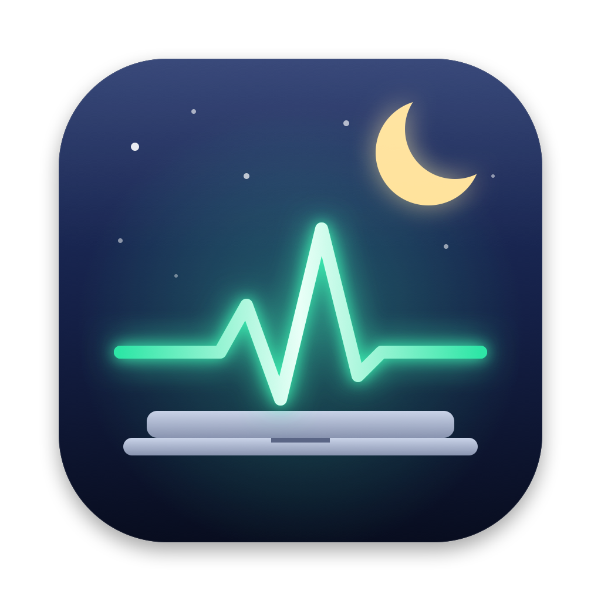

<p align="center"></p>

<h1 align="center">KeepMeAlive</h1>

**Close your MacBook lid. Your AI agents keep working.**

KeepMeAlive is a free, open-source menu bar app for macOS. It keeps Claude Code, Codex,
Cursor and other coding agents running with the lid closed. It pauses every other
app, turns the screen off, and keeps you online. If Wi-Fi drops, it switches to
your phone's hotspot.

> ⚠️ A Mac working with its lid closed still makes heat. Keep it on a hard surface
> with airflow. Never leave it in a closed bag during a session. KeepMeAlive ends the
> session at low battery or critical heat, but that does not make it safe in a bag.

---

## Why

Close a MacBook's lid and macOS puts it to sleep. Agent sessions, long builds and
SSH tunnels all freeze, and they are usually dead when you open it again. The
usual workarounds (`caffeinate`, Amphetamine, an external display) either don't
work with the lid closed on battery, or keep the whole Mac running at full power.

KeepMeAlive does it differently:

| | |
|---|---|
| 🔒 **Lid-proof** | Keeps the Mac awake with the lid closed, on battery, with no external display. |
| 🎯 **Only what you choose stays alive** | You pick the keep-alive apps. When the lid closes, every other app is paused (it uses no CPU and no network) and resumes the moment the lid opens. |
| 🖥️ **Screen off** | The display turns off. Only the work you chose keeps running. |
| 📶 **Always online** | It checks for real internet access every 10 s. If Wi-Fi is off it turns it back on. If the internet stays down it joins your phone's Personal Hotspot, and it moves back to your Wi-Fi when that returns. |
| 🤖 **Agent-aware** | Auto mode stays awake only while an agent app or CLI (`codex`, `claude`, `cursor-agent`, …) is running. A terminal running an agent is never paused. |
| 🛟 **Crash-safe** | A small watchdog turns sleep back on and resumes paused apps within a minute if KeepMeAlive crashes. |
| 🔋 **Safety rules** | Ends the session below a battery level you set (10 % by default) or at critical heat. |
| ⌨️ **Scriptable** | `KeepMeAlive on 2h`, `KeepMeAlive off`, `KeepMeAlive status`. Agents can control it too. |

## Install

Requires **macOS 14 (Sonoma) or later**. Apple silicon and Intel are both supported.

### Option A: download the DMG (easiest)

1. Download **`KeepMeAlive-vX.Y.Z.dmg`** from the [latest release](https://github.com/naaji-navas/KeepMeAlive/releases/latest).
2. Open it and drag **KeepMeAlive** into **Applications**.
3. Open KeepMeAlive from Applications. This open-source build isn't notarized by Apple,
   so the first time macOS says it can't verify the developer. Click **Done**, open
   **System Settings → Privacy & Security**, scroll down and click **Open Anyway**.
   You only do this once.

Prefer Terminal? The release also includes a `.zip` with an `install.sh` that copies
the app to `~/Applications` and skips the Gatekeeper step.

### Option B: build from source (for contributors)

All you need is the Xcode **Command Line Tools** (`xcode-select --install`). Full Xcode is optional.

```bash
git clone https://github.com/naaji-navas/KeepMeAlive.git
cd KeepMeAlive
./scripts/install.sh
```

### First run

1. A setup window opens and explains what lid-proof mode installs. Click
   **Set Up Lid-Proof Mode** and enter your password once (see [How it works](#how-it-works)).
   It also installs the crash watchdog and asks to allow notifications.
   Chose **Not Now**? Click the 🌙 in the menu bar, then **Set up lid-proof mode…** any time.
2. Click the 🌙 in the menu bar.
3. Check the **Keep alive** list. On first launch KeepMeAlive adds any of these it finds
   installed: Claude, Codex, ChatGPT, Cursor, Windsurf, VS Code, Zed, Terminal,
   iTerm2, Ghostty and Warp. Click **+** to add more apps.
4. Optional: in **Settings → Internet**, enter your phone's hotspot name and password.
5. Pick a duration (∞, 1h, 2h, 4h, 8h or **Auto**). The icon turns into a heartbeat. Close the lid.

To see what a lid close would pause right now, without changing anything:

```bash
~/Applications/KeepMeAlive.app/Contents/MacOS/KeepMeAlive preview
```

## Using it

| Duration | Meaning |
|---|---|
| ∞ | Until you turn it off |
| 1h / 2h / 4h / 8h | Timed. Use **+30m** or **+1h** to extend it |
| **Auto** | Awake only while a keep-alive app or agent CLI is running. Sleep is allowed again when they all quit |

### Command line

```bash
MA=~/Applications/KeepMeAlive.app/Contents/MacOS/KeepMeAlive
$MA on            # until stopped
$MA on 90         # 90 minutes (also: 2h, 45m)
$MA on auto       # while agents run
$MA extend 30
$MA status        # exit code 0 when awake
$MA off
$MA preview       # dry run: what a lid close would pause
```

Tip: add `alias keepmealive="$MA"` to your shell profile, or tell your agent to run
`$MA on auto` before a long task.

### Mobile-data failover

1. On your iPhone, turn on **Settings → Personal Hotspot → Allow Others to Join**.
2. In KeepMeAlive **Settings → Internet**, enter the hotspot name and password, then click Save.
   The password is stored in your login Keychain.
3. Allow **Location access** when asked. macOS only shows Wi-Fi network names to apps
   that have it. KeepMeAlive never reads your location.
4. Click **Test failover now** to check that it works.

During a session, if the internet stays down longer than the grace period (20 s by
default), KeepMeAlive joins the hotspot. When your normal Wi-Fi is back in range and
working, it moves back to it to save mobile data. An iPhone connected by USB is
picked up by macOS automatically.

## How it works

| Piece | Mechanism |
|---|---|
| Lid-proof sleep | `pmset -a disablesleep 1` during a session, `0` after. This is the only switch that survives a lid close on battery, and it needs root. KeepMeAlive installs one sudoers rule, `/etc/sudoers.d/keepmealive`, that lets **your user** run **exactly these two commands** without a password. Nothing else. |
| Idle sleep | An IOKit `PreventUserIdleSystemSleep` assertion. This works even before setup. |
| Pausing apps | `SIGSTOP` on each non-kept app and its child processes, then `SIGCONT` when the lid opens. Paused apps keep all their state. Keep-alive apps, agent CLIs, everything they started and everything they run inside are never paused. Neither are macOS UI, meeting apps, VPN clients, password managers or dictation apps. |
| Lid detection | `AppleClamshellState` from `IOPMrootDomain`. |
| Screen off | `pmset displaysleepnow`, repeated if the display wakes while the lid is closed. |
| App Nap | Optionally sets `NSAppSleepDisabled` for keep-alive apps only, and removes it when you take an app off the list. |
| Network | `NWPathMonitor` and HTTP probes (Apple captive portal check and Cloudflare trace), with CoreWLAN to scan for and join the hotspot. |
| Crash safety | `~/Library/Application Support/KeepMeAlive/state.json` records every change. A LaunchAgent (`com.keepmealive.watchdog`), installed during lid-proof setup, runs every minute. Apps are only paused once it is in place. If the app is gone, it resumes paused processes and turns sleep back on. The app does the same cleanup at its next launch. |

### What KeepMeAlive changes on your Mac

- `~/Applications/KeepMeAlive.app`
- `/etc/sudoers.d/keepmealive`: only if you enable lid-proof mode
- `~/Library/LaunchAgents/com.keepmealive.watchdog.plist` and `~/Library/Application Support/KeepMeAlive/`
- `~/Library/Logs/KeepMeAlive/`: logs can contain Wi-Fi names, so check them before sharing
- A Keychain item, `com.keepmealive.hotspot`, if you set up a hotspot

### Limitations

- On Apple silicon and T2 Macs, closing the lid disconnects the built-in microphone in hardware.
- An app that opened before you added it to the keep-alive list picks up the App Nap change only after it restarts.
- Signing ad hoc gives every build a new identity. After you update, macOS may ask once to allow Keychain access to the hotspot password, and Location access may need to be granted again.
- Your Mac may lock when the display sleeps. Agents that drive the screen (computer use) stop at the lock screen. Terminal and API agents are not affected.

## Uninstall

```bash
./scripts/uninstall.sh          # app, watchdog, sleep rule (restores sleep first)
./scripts/uninstall.sh --purge  # also settings and logs
```

Installed from the DMG? `uninstall.sh` is also in the release `.zip`, or run it
straight from GitHub:

```bash
curl -fsSL https://raw.githubusercontent.com/naaji-navas/KeepMeAlive/main/scripts/uninstall.sh | sh
```

If something ever goes wrong, this always restores normal sleep:

```bash
sudo pmset -a disablesleep 0
```

## Development

```bash
swift build                 # debug build
./scripts/build-app.sh      # build/KeepMeAlive.app (release, ad-hoc signed)
./scripts/package-release.sh v0.2.0   # release zip + sha256
./scripts/make-dmg.sh v0.2.0          # drag-to-install DMG + sha256
```

Pushing a `v*` tag runs `.github/workflows/release.yml`, which builds the DMG and the
zip and publishes a GitHub release.

```
Sources/KeepMeAlive/
  Core/     AwakeEngine (session state machine), Config, CLI, Support (paths, log, shell)
  System/   SleepControl (pmset, assertions, lid), AppFreezer (process tree, SIGSTOP),
            NetworkGuardian (probe, failover, Keychain), PowerSafety, Watchdog
  UI/       MenuPanel (menu bar popover), SettingsView
Resources/  Info.plist, watchdog.sh
```

See [CONTRIBUTING.md](CONTRIBUTING.md) and [SECURITY.md](SECURITY.md).

## Acknowledgements

Inspired by [Insomnia](https://github.com/krishhgg/Insomnia), which showed that
`disablesleep` together with a launchd backstop is a workable approach. KeepMeAlive
is an independent implementation built around per-app keep-alive and network failover.

## License

[MIT](LICENSE)
